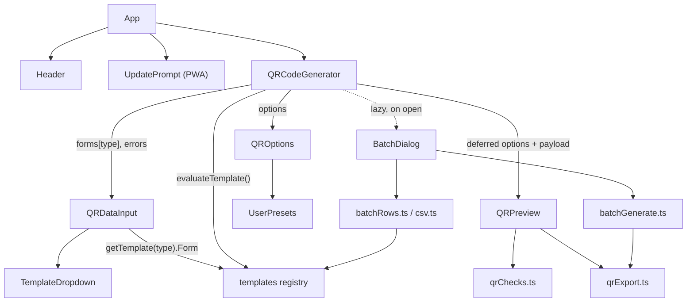

# Architecture

Client-side React 19 + TypeScript + Vite SPA. No backend, no network calls from app code: everything
runs in the browser and ships as static files.

## Component map



| Component | Path | Role |
|-----------|------|------|
| `App` | `src/App.tsx` | Theme (`data-theme`), `LanguageProvider`, layout |
| `QRCodeGenerator` | `src/components/QRCodeGenerator/` | Owns the editor state; the only stateful orchestrator |
| `QRDataInput` | `src/components/QRDataInput/` | Template dropdown + the form of the selected template (controlled by the parent) |
| `QROptions` | `src/components/QROptions/` | Styling panel (error correction, dot/corner styles, colors, background, logo, built-in and user presets), undo/redo/reset buttons |
| `QRPreview` | `src/components/QRPreview/` | Live QR, capacity error, scannability warnings, PNG/SVG/PDF export, copy to clipboard |
| `BatchDialog` | `src/components/Batch/` | CSV to ZIP of QR images, lazy-loaded |
| `UpdatePrompt` | `src/components/UpdatePrompt/` | "New version" / "offline ready" toast |
| Templates | `src/templates/` | 20 pure `QRTemplate` modules + forms + registry (see [templates.md](templates.md)) |
| i18n | `src/i18n/` | `en`/`it`/`ro` dictionaries (see [i18n.md](i18n.md)) |

## Data flow in `QRCodeGenerator`

```
useReducer(historyReducer) ── current: EditorState { options: QROptions, forms: TemplateFormData }
        │
        ├─ evaluateTemplate(templateType, forms[templateType])   (useMemo)
        │        └─ { errors, payload }       payload = '' while the data is invalid
        │
        ├─ payload ──500 ms debounce──▶ debouncedData
        │        └─ previewOptions = { ...options, data: debouncedData }
        │                └─ useDeferredValue ──▶ <QRPreview options=…>
        │
        ├─ editor ──500 ms debounce──▶ dispatch({ type: 'commit' })      (undo step)
        └─ options ─300 ms debounce──▶ localStorage (styling only)
```

| Mechanism | Detail | Source |
|-----------|--------|--------|
| Editor state | `options` (styling, selected `templateType`, logo `image`) and `forms` (one data object per template, all kept alive when switching) | `QRCodeGenerator.tsx` |
| History reducer | Pure reducer: actions `edit`, `commit`, `undo`, `redo`, `reset`. `current` is live; `entries` are committed snapshots (max `MAX_HISTORY` = 50). A burst of edits becomes one undo step because `commit` is dispatched after a 500 ms pause. Undo/redo commit pending edits first. `reset` is itself an undo step and is a no-op when already at default (`deepEqual`) | `history.ts` |
| Keyboard | `Ctrl/Cmd+Z` undo, `Ctrl/Cmd+Shift+Z` or `Ctrl+Y` redo; ignored inside `INPUT`, `TEXTAREA`, `SELECT`, contenteditable (the browser's own undo applies there) | `QRCodeGenerator.tsx` |
| Debounce | `DEBOUNCE_MS = 500` for the preview payload and the history commit; `PERSIST_DEBOUNCE_MS = 300` for the localStorage write | `QRCodeGenerator.tsx` |
| `useDeferredValue` | Color/range inputs fire an event per step; the preview renders at low priority and skips intermediate values instead of calling `QRCodeStyling.update()` for each | `QRCodeGenerator.tsx` |
| Persistence | Only `toPersistableOptions(options)` (= options minus `data` and `image`) under `qr-generator-settings`. Loaded through `parseSavedOptions`, which validates and clamps untrusted JSON and merges it with defaults | `savedOptions.ts` |
| Size/margin rule | A `size` update clamps `margin` to 15% of the size (`MARGIN_RATIO`). The size has no UI today (fixed at 300); exports pick their own pixel side | `QRCodeGenerator.tsx` |

### Template registry

`src/templates/index.ts` holds `registry`, typed `{ [K in QRTemplateType]: QRTemplate<TemplateDataMap[K]> }`
(a missing or mistyped entry is a compile error). Each `QRTemplate` has `type`, `category`, `icon`,
`defaultData`, `validate` (pure, returns only the invalid fields as `ErrorKey`), `buildPayload` (pure,
assumes validity, returns `''` for nothing to encode) and `Form`. Consumers: `evaluateTemplate`,
`getTemplate`, `createDefaultFormData`, `isTemplateType` (used to validate the saved `templateType`),
the dropdown, and the batch.

### QRPreview

| Concern | Detail | Source |
|---------|--------|--------|
| Live instance | One `QRCodeStyling` created once and `update()`d in place; recreated only when an update throws (the library clears the container before regenerating); last good render kept on capacity errors | `QRPreview.tsx` |
| Option mapping | `buildQROptions(options, px, data)` maps `QROptions` to qr-code-styling options; margins and logo margin scale with `px`; logo size ratio `imageSize / 0.3` | `qrExport.ts` |
| Capacity | `getCapacity`: UTF-8 bytes vs version 40 byte-mode limits (L 2953, M 2331, Q 1663, H 1273). Exceeding shows an error and blocks export. Byte-mode only: a very long numeric payload is rejected even if it would fit in numeric mode | `qrChecks.ts` |
| Scannability warnings | Non-blocking: `lowContrast` (worst WCAG contrast of dots/gradient stops/corners vs background < 4.5; transparent background assumed white), `inverted` (any foreground lighter than the background), `logoNeedsHighEc` (logo with error correction L or M) | `qrChecks.ts` |
| Exports | Offscreen `renderBlob(options, 'png' \| 'svg', px)`. PNG/SVG at 512 / 1024 (default) / 2048 px. PDF: A4 portrait, QR centered, side 5 cm, 10 cm (default) or A4-fit (180 mm = 210 mm minus 15 mm margins), rendered at ≥ 300 DPI. Copy to clipboard (PNG) shown only when `ClipboardItem` exists | `qrExport.ts`, `QRPreview.tsx` |
| File name | `qr-<template>-<yyyymmdd-hhmm>.<ext>` | `buildFileName` |
| Logo | `QROptions` accepts PNG/JPEG/WebP/SVG up to 2 MiB (file picker or drop), read as a data URL; error correction is raised to H when it was L or M | `QROptions.tsx` |

### User presets

`UserPresets` stores `{ name, style }` entries (style = dot/corner/background colors and types, gradient,
transparency; never `data` or `image`) under `qr-generator-presets`. Limits: 50 presets, 40-char names, imports
up to 256 KiB. JSON export is `{ format: 'qr-code-builder-presets', version: 1, presets }`; import accepts that
envelope or a bare array, validates every entry strictly (hex colors, enums, gradient ranges; unknown keys
dropped, invalid entries skipped) and merges by case-insensitive name (same name replaces).

### Batch (CSV to ZIP)

`BatchDialog` is opened from the `QRDataInput` area and loaded with `lazy()`. Flow:

1. Pick a template (columns = keys of the template's `defaultData()` plus optional `filename`); download a header-only CSV (`;`-delimited with BOM when the UI is not English, `,` otherwise).
2. Upload a CSV (max 2 MiB, 500 rows). `csv.ts` parses RFC 4180, detects `,` `;` or tab, strips a BOM; text decoded as UTF-8, falling back to Windows-1252.
3. `buildBatchRows` coerces cells (booleans, closed choices such as Wi-Fi encryption, ISO dates), runs the template's own `validate` and `buildPayload`, checks capacity for the current error correction level, sanitizes and de-duplicates file names (`a`, `a-2`, ...). Invalid rows are shown and skipped.
4. `generateBatchZip` renders valid rows sequentially with `renderBlob` (current styling, chosen PNG/SVG and size), yields to the event loop between rows, supports cancel (`AbortController`), then zips with `fflate` (`level` 0 for PNG, 6 for SVG) and downloads `qr-batch-<yyyymmdd-hhmm>.zip`. Rows that fail to render are reported.

Nothing from a batch is persisted.

## Lazy chunks

| Chunk | Loaded when | Mechanism |
|-------|-------------|-----------|
| `jspdf` (+ `html2canvas`, `purify`, `index.es`) | First PDF export | `import('jspdf')` in `QRPreview.tsx`; excluded from the PWA precache, runtime-cached (see [deploy.md](deploy.md)) |
| `react-select` + `libphonenumber-js` | A phone template (phone, sms, whatsapp) is shown | `lazy(() => import('./CountryCodeSelectInner'))`; a disabled `<select>` is the fallback. `toE164` deliberately does not import `libphonenumber-js` so the builders stay out of that chunk |
| Batch dialog | "Batch" button clicked | `lazy(() => import('../Batch/BatchDialog'))` |
| `fflate` | Generate clicked in the batch | `await import('fflate')` in `batchGenerate.ts` |

Only the three UI-language flag SVGs are bundled (`Flags.tsx`, from `flag-icons`); country dialing codes use
`libphonenumber-js` + `Intl.DisplayNames`, no flag images.

## PWA update flow

`vite-plugin-pwa` with `registerType: 'prompt'` (`vite.config.ts`). `UpdatePrompt` uses `useRegisterSW()`:
`needRefresh` shows "update available" with **Reload** (`updateServiceWorker(true)`) and **Later**;
`offlineReady` shows a one-time "ready offline" notice. The page is never reloaded automatically, because the
form data lives only in memory ([privacy.md](privacy.md)).

## Theme and language

- Theme: `data-theme` on `<html>`. The initial value is the saved choice, else the OS preference at load (dark when it expresses none). Only an explicit toggle is saved (`qr-generator-theme`); the OS preference is not tracked live.
- Language: saved choice, else `navigator.language` (`it`, `ro`, otherwise `en`); `<html lang>` follows it.
